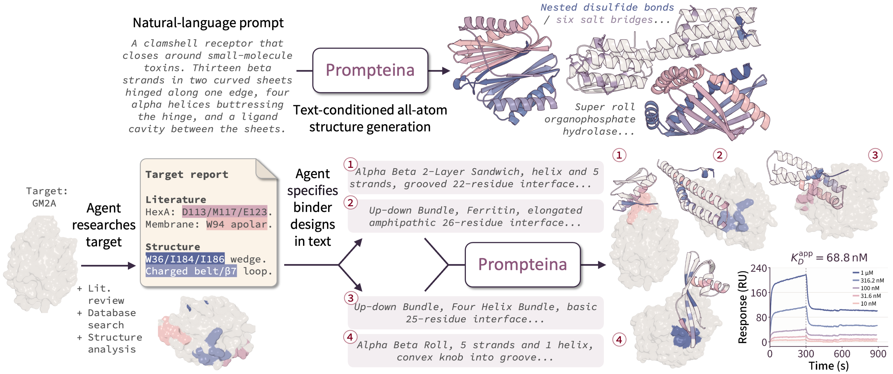

<!--
Modified by the Prompteina authors in 2026.
Changes are licensed under Apache 2.0; see LICENSE and NOTICE.
-->

# Designing Protein Structures from Natural Language

<p align="center">
  <a href="https://jxlee.me">Joseph Lee</a><sup>1</sup>,
  <a href="https://yanjinglili.github.io/">Yanjing Li</a><sup>1</sup>,
  <a href="https://github.com/qiangbo1222">Bo Qiang</a><sup>1</sup>,
  <a href="https://www.comp.nus.edu.sg/~greglau/">Gregory Lau</a><sup>2</sup>,
  <a href="https://aetting.github.io/">Allyson Ettinger</a><sup>3</sup>,
  <a href="https://nasmith.github.io/">Noah A. Smith</a><sup>1,3</sup>,<br>
  <a href="https://donovanr.github.io/">Rory Donovan-Maiye</a><sup>3</sup>,
  <a href="https://www.ipd.uw.edu/david-baker/">David Baker</a><sup>1,4</sup>,
  <a href="https://hannaneh.ai/">Hanna Hajishirzi</a><sup>1</sup>,
  <a href="https://koh.pw/">Pang Wei Koh</a><sup>1</sup>
</p>
<p align="center">
  <sup>1</sup>University of Washington &nbsp;
  <sup>2</sup>National University of Singapore &nbsp;
  <sup>3</sup>Allen Institute for AI (Ai2) &nbsp;
  <sup>4</sup>Howard Hughes Medical Institute
</p>

<p align="center">
  <a href="https://jxlee.me/prompteina">🌐 Project page</a>
  &nbsp;·&nbsp;
  <a href="https://arxiv.org/abs/2610.13917">📄 Paper</a>
  &nbsp;·&nbsp;
  <a href="https://huggingface.co/jleechung/prompteina">🤗 Model weights</a>
  &nbsp;·&nbsp;
  <a href="https://huggingface.co/datasets/jleechung/prompteina-data">🤗 Training data</a>
</p>

<div align="center">
    
</div>

<br>

## Overview

Prompteina is a text-conditioned all-atom protein structure generation model
that takes as input a natural language prompt and generates an all-atom
structure. Using a single natural language interface, Prompteina specifies
desired structural and functional properties of generated proteins. This
includes but is not limited to:

- **Fold and topology:** CATH class and architecture, for the whole protein or
  per domain
- **Secondary structure:** the number of helices, strands and sheets, and the
  sheet topology
- **Tertiary motifs:** the number of disulfide bonds and salt bridges
- **Global shape:** size, compactness, symmetry, contact order, flexibility
- **Surface properties:** planarity, spatial aggregation propensity, buried
  unsatisfied polar groups
- **Interface:** the number of interface residues, the buried surface area, the
  interface geometry, hydrophobicity
- **Function:** a family or activity, such as a lysozyme or a green fluorescent
  protein

Prompteina currently supports monomer and protein binder design and integrates
with agents in design campaigns. We experimentally validated Prompteina against
[GM2A](https://en.wikipedia.org/wiki/GM2A), a protein implicated in [GM2
gangliosidosis](https://en.wikipedia.org/wiki/GM2_gangliosidoses) with no
previously reported *de novo* binders. Prompteina yielded nine binders from 90
designs tested.

## Installation

``` bash
git clone https://github.com/jleechung/prompteina.git
cd prompteina
```

Prompteina requires Python 3.12 and CUDA 12.6. Build the environment with

``` bash
./env/build_uv_env.sh
source .venv/bin/activate
```

By default, `build_uv_env.sh` creates `.venv/` and installs uv if needed. Pass
`--root PATH` to use another location, or `--minimal` to skip JAX, which only
the AlphaFold3 backend uses.

Prompteina uses two frozen text encoders (Qwen3-Embedding-8B and Qwen3-8B) for
text conditioning. Together they occupy about 32 GB of GPU memory. Prompteina
downloads them from Hugging Face the first time it builds a model.

## Weights

Download the Prompteina monomer and binder checkpoints from Hugging Face:

``` bash
hf download jleechung/prompteina --local-dir ./weights
```

Download the Complexa base denoiser and frozen autoencoder:

``` bash
./env/download_startup.sh --complexa
./env/download_startup.sh --status
```

Set `CKPT_PATH` to the weights directory and `AE_CKPT` to the separately
downloaded autoencoder:

``` bash
export CKPT_PATH=./weights
export AE_CKPT=./ckpts/complexa_ae.ckpt
```

## Quick Start

We provide example prompts to get started. For monomer generation,
`examples/monomer_prompts.csv` includes a CATH architecture, a two-domain
protein and a protein with internal symmetry. Generate one design for each
prompt:

``` bash
CKPT_NAME=prompteina-monomer.ckpt \
TEXTCOND_CSV=examples/monomer_prompts.csv \
python -m proteinfoundation.generate \
    --config-name text_monomer_generate \
    root_path=./inference/monomers \
    generation.args.guidance_w=2.0 \
    generation.dataloader.dataset.nrepeat_per_sample=1
```

For binder generation, `examples/binder_prompts.csv` includes three prompts for
PD-L1 binders targeting A37, A39, A49 and A98. Generate one design for each
prompt:

``` bash
CKPT_NAME=prompteina-binder.ckpt \
TEXTCOND_CSV=examples/binder_prompts.csv \
DATA_PATH=./assets \
python -m proteinfoundation.generate \
    --config-name text_binder_generate \
    root_path=./inference/02_PDL1 \
    generation.task_name=02_PDL1 \
    generation.args.guidance_w=1.0
```

We define other binder targets and their default hotspot residues in
`configs/targets/targets_dict.yaml`.
Prompt CSVs require a `description` column; `accession`, `nres`, `nres_min`,
`nres_max` and `hotspot_residues` are optional. We recommend CFG 2.0 for
monomer generation and CFG 1.0 for binder design, as set above.

To free GPU memory after prompt encoding, append
`text_cond.offload_text_encoders=true` to either generation command.

## Evaluation

We provide code to evaluate generated binders. Refold each design and score its
interface with ipSAE_min:

``` bash
python -m proteinfoundation.evaluate_binders \
    --designs ./inference/02_PDL1 \
    --out ./scores/02_PDL1.csv \
    --backend esmfold2-fast \
    --sequences self mpnn mpnn-fi
```

Choose `esmfold2-fast`, `esmfold2` or `alphafold3` with `--backend`. Install the
selected backend separately; `build_uv_env.sh` includes neither ESMFold2 nor
AlphaFold3:

- For ESMFold2, install the `esm` package into its own environment. It depends
  on a fork of transformers.
- For AlphaFold3, set `AF3_SRC` to the source root holding `run_alphafold.py`,
  and `AF3_MODEL_DIR` to the directory holding `af3.bin`. AlphaFold3 runs
  single-sequence and uses the designed structure as a template.

Use `--sequences` to choose sequence conditions. `self` scores the co-designed
sequence, `mpnn` applies a free ProteinMPNN redesign, and `mpnn-fi` redesigns
the sequence while holding the generated interface fixed. For either redesign,
download the ProteinMPNN weights with `./env/download_startup.sh --pmpnn`.

By default, ipSAE uses the vendored DunbrackLab reference implementation in
`community_models/IPSAE/`. Use `--ipsae inprocess` to select
`metrics/ipsae.py` and avoid a subprocess per design.

## Agentic Design

Here, we provide scaffolding code for using an agent with the design model. The
agent first researches a design objective through web search and structure
queries, then turns the resulting research into design specifications.

Install dependencies:

``` bash
uv pip install anthropic pyyaml
export ANTHROPIC_API_KEY=sk-ant-...
python -m proteinfoundation.agent.design_agent \
    --target 02_PDL1 --method prompteina --n-designs 200 --out ./specs
```

Pass the resulting `02_PDL1.prompts.csv` as `TEXTCOND_CSV`.

The agent writes each design as `- Label: value` bullets, then converts the
block into a prose caption in the same call. The caption becomes the
`description`. Pass `--no-caption` to send the bullets to the model
unconverted. `nres_min`, `nres_max` and `hotspot_residues` become their own
columns rather than prose.

The agent researches each target once and reuses the dossier across methods.
Skill files in `agent/method_refs/` define method-specific properties:
`prompteina.SKILL.md`, `rfd3.SKILL.md` and `boltzgen.SKILL.md`.

Target research uses the structure-query tools in `agent/target_tools.py`:
`target_overview`, `secondary_structure`, `surface_residues`, `neighbors`,
`surface_patches` and `known_interfaces`.

For target-free monomer design, use *monomer_agent*. It searches the literature
for the design objective, then combines its dossier with a case study card:

``` bash
python -m proteinfoundation.agent.monomer_agent \
    --case-study nanopore --n-designs 24 --out ./specs
```

Case study cards live in `agent/case_studies/`. The included `nanopore.md`
targets a single-chain transmembrane beta-barrel with an open lumen. Add an
objective by writing a card and registering it in `CASE_STUDIES`.

## Training

Set `DATA_PATH` to the dataset root. Run each training stage through *train*.

First, warm up the text modules with the denoiser frozen:

``` bash
python -m proteinfoundation.train --config-name training_local_latents \
    branch=text freeze=init_frozen
```

Continual pretraining then unfreezes the denoiser:

``` bash
python -m proteinfoundation.train --config-name training_local_latents \
    branch=text freeze=full \
    dataset=unified/monomer_text_align
```

Alignment fine-tuning trains the alignment head together with the text
projectors and the value and output projections of the late cross-attention
layers:

``` bash
python -m proteinfoundation.train --config-name training_local_latents \
    branch=text freeze=align_xattn_vout_late \
    alignment_head=cross_attn_delta \
    dataset=unified/dimers_text_align
```

Finally, continue training on dimers to produce the binder model:

``` bash
python -m proteinfoundation.train --config-name binder_train \
    pretrain_ckpt_path=/path/to/stage3.ckpt \
    autoencoder_ckpt_path=$AE_CKPT \
    hydra.run.dir=./runs/binder run_name=binder
```

## Data

We are preparing the dataset for public release. It will be available shortly.

## Acknowledgments

We built this codebase on top of
[Proteina-Complexa](https://github.com/NVIDIA-Digital-Bio/Proteina-Complexa).
We thank the authors for releasing their code.

## License

Code is licensed under Apache 2.0, model weights under the NVIDIA Open Model
License, and repository data assets under CC BY 4.0. See `licenses/` and
`NOTICE`.

## Contributing

Open bug reports, questions and enhancement requests on the
[issue tracker](https://github.com/jleechung/prompteina/issues).
